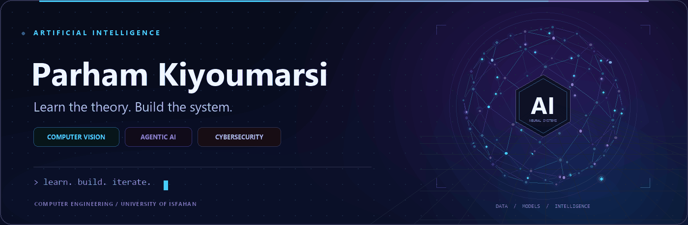

<div align="center">



<br />


**Computer Engineering @ University of Isfahan**

<br />

[](https://www.linkedin.com/in/parham-kiyoumarsi-a36219397/)
[](mailto:parham.kiyoumarsi@mehr.ui.ac.ir)
[](https://github.com/parhamKIY?tab=repositories)

[About](#whoami) · [Projects](#projects) · [Tech stack](#tech-stack) · [Research & teaching](#research--teaching)

</div>

## `whoami`


I'm **Parham**, a final-year Computer Engineering student focused on **Artificial Intelligence** and **Computer Networks**.

I work with **machine learning, deep learning, computer vision, and agentic AI**, with a particular interest in cybersecurity. I like building the software around a model as much as working on the model itself.

I've also applied these interests to IoT and medical research, coauthored **two publications**, and helped other students learn as a **teaching assistant and head TA**.

<br clear="right" />

```python
parham = {
    "core": "Artificial Intelligence",
    "builds": ["ML / DL", "Computer Vision", "Agentic AI"],
    "interests": ["AI for Cybersecurity", "Intelligent Applications"],
    "background": "Computer Networks"
}
```

## Projects

### [Paper Research Assistant](https://github.com/parhamKIY/LLM)

A bilingual assistant for searching scientific papers and asking questions about their contents, with document retrieval, tool calling, and voice input.

<sub>RAG · FAISS · Sentence Transformers · Whisper</sub>

### [Image CAPTCHA Solver](https://github.com/parhamKIY/captcha-braker-)

An image-based CAPTCHA project combining YOLO classification with Selenium, including class balancing, augmentation, and test-time augmentation.

<sub>Computer Vision · YOLO · PyTorch · Selenium</sub>

### [Network Anomaly Detection](https://github.com/parhamKIY/anomaly-detection-project)

Network anomaly detection with classical and deep models, plus black-box evasion experiments using a surrogate model. Includes LLM-assisted analysis of detected anomalies.

<sub>Isolation Forest · Autoencoders · 1D CNN · Adversarial ML</sub>

### [IoT Trust Assessment](https://github.com/parhamKIY/Providing-a-Method-to-Improve-the-Level-of-Trust-in-IOT-Networks-Using-Deep-Learning-Structure)

An implementation of our published work combining SMART trust scoring with LSTM-based analysis of behavioral changes in IoT networks.

<sub>Deep Learning · LSTM · Trust Modeling · IoT</sub>

<details>
<summary><strong>Other projects</strong></summary>

<br />

- **[Credit Limit Prediction](https://github.com/parhamKIY/DATA_MINING)** — Feature engineering, regression models, and neural networks for tabular data.
- **[Smart Parking Management](https://github.com/parhamKIY/SmartParkingManagementSystem)** — A team IoT course project with a web application.
- **[Neural Choice Decoding](https://github.com/parhamKIY/neuroconnect-project)** — Exploring behavioral choice prediction from neural population activity.
- **[Reliable Transport Simulation](https://github.com/parhamKIY/TCP-connection-simulation)** — A reliable data-transfer protocol over UDP.
- **Clinical Variant Web Application** — A private research application for genomic evidence aggregation and LLM-assisted interpretation with expert review. Manuscript in preparation.
- **[Gene Selection for Cancer Classification](https://github.com/parhamKIY/A-Feature-Selection-Method-on-Gene-Expression-Microarray-Data-for-Cancer-Classification-Abstract)** — A published feature-selection method combining variance filtering, randomized trees, and whale optimization.
- **[Visual DSD Rebooted](https://github.com/parhamKIY/Visual-DSD-rebooted)** — A modern workspace around the original DNA strand-displacement simulation core, with guided scientific activities.

</details>

## Tech stack

<div align="center">

<br /><br />


</div>

<br />

- **Models & data:** machine learning, deep learning, neural networks, NumPy, pandas, Jupyter.
- **Vision & language:** YOLO, RAG, semantic search, LLM tool calling, research assistants.
- **Applications & systems:** Python, C++, SQL, React / TypeScript, Git, Docker, Linux.
- **Foundations:** computer networks, network security, digital signal processing.

## Research & teaching

**Research internship · Summer 2026**<br />
Agentic AI & Medical Genomics — Medical Image and Signal Processing Research Center, Isfahan University of Medical Sciences.

**Head Teaching Assistant · Spring 2026**<br />
Computer Networks · Signals and Systems — University of Isfahan.

**Teaching Assistant · Fall 2024**<br />
Fundamentals of Programming with C++ — University of Isfahan.

**B.Sc. in Computer Engineering · University of Isfahan**<br />
AI focus · Computer Networks background · Expected graduation: Spring 2027.

### Publications

- **[Providing a Method to Improve the Level of Trust in IoT Networks Using Deep Learning Structure](https://srb.sanad.iau.ir/en/Article/1194560)**<br />
  *Artificial Intelligence Tools in Software and Data Engineering* · [Implementation](https://github.com/parhamKIY/Providing-a-Method-to-Improve-the-Level-of-Trust-in-IOT-Networks-Using-Deep-Learning-Structure)
- **[A Feature Selection Method on Gene Expression Microarray Data for Cancer Classification](https://sanad.iau.ir/Journal/josc/Article/1189068/FullText)**<br />
  *Journal of Optimization in Soft Computing* · [Implementation](https://github.com/parhamKIY/A-Feature-Selection-Method-on-Gene-Expression-Microarray-Data-for-Cancer-Classification-Abstract)

## GitHub activity

<div align="center">


<br /><br />

[Start a conversation](mailto:parham.kiyoumarsi@mehr.ui.ac.ir) · [Find me on LinkedIn](https://www.linkedin.com/in/parham-kiyoumarsi-a36219397/)

</div>


