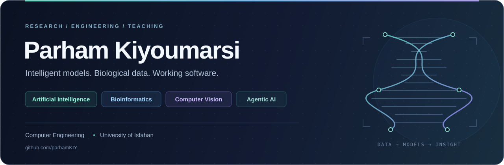
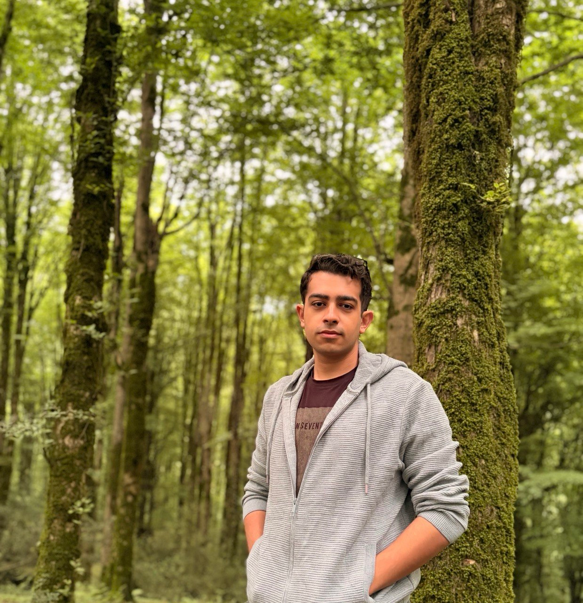

**Computer Engineering · University of Isfahan · Isfahan, Iran**

I build research software that connects intelligent models with biological data, images, and real applications.

[About](#about-me) · [Projects](#selected-work) · [Publications](#research--publications) · [Experience](#research--teaching) · [Toolbox](#technical-toolbox)

## About me

I'm **Parham**, a final-year Computer Engineering student at the **University of Isfahan**, with a focus on artificial intelligence and computer networks.

My work spans **bioinformatics, computer vision, language models, and cybersecurity**. I've worked on gene-expression feature selection, clinical variant interpretation software, visual recognition pipelines, and assistants that retrieve evidence from scientific papers.

I enjoy the engineering around the model, too: shaping the data, building the interface, connecting services, and making the result usable. Alongside my projects, I've **coauthored two research publications**, worked as a **research intern in medical genomics and agentic AI**, and supported students as a **teaching assistant and head TA**.

The questions I keep coming back to: *What evidence supports the answer? How does the system fail? Can someone else use and reproduce the work?*

 

## Areas I work in

| Area | What that looks like in my work |
| :--- | :--- |
| **Artificial intelligence & language systems** | Machine learning, deep learning, retrieval-augmented generation, semantic search, and LLM tool calling. |
| **Bioinformatics & scientific computing** | Gene-expression analysis, feature selection for cancer classification, genomic evidence workflows, and molecular simulation tools. |
| **Computer vision** | Image classification with YOLO, class balancing, augmentation, and connecting visual predictions to browser automation. |
| **Cybersecurity, networks & IoT** | Network anomaly detection, adversarial evasion experiments, trust assessment, and connected application development. |

## Selected work

<table>
  <tr>
    <td width="50%" valign="top">
      <h3>🧬 Visual DSD Rebooted</h3>
      
A modern local workspace built around the original Visual DSD scientific core: DNA strand-displacement models, reaction networks, simulations, and guided bioinformatics activities.

      
Scientific software · Molecular computing · F# / .NET

      
<a href="https://github.com/parhamKIY/Visual-DSD-rebooted">Explore the project →</a> · <a href="https://github.com/parhamKIY/Visual-DSD-rebooted/releases">Releases</a>

    </td>
    <td width="50%" valign="top">
      <h3>🔬 Clinical Variant Interpretation</h3>
      
A genomic analysis web application that assembles source-attributed evidence, prepares LLM-assisted interpretation drafts, and supports expert review and reporting. Includes experimental query-privacy mechanisms.

      
Medical genomics · Python · React / TypeScript · Docker

      
<strong>Private research project</strong> · Manuscript in preparation

    </td>
  </tr>
  <tr>
    <td width="50%" valign="top">
      <h3>📚 Scientific Paper Assistant</h3>
      
A bilingual research assistant combining document retrieval, semantic search, LLM function calling, and voice input to help explore scientific papers and compare their findings.

      
RAG · FAISS · Sentence Transformers · Whisper

      
<a href="https://github.com/parhamKIY/LLM">Explore the project →</a>

    </td>
    <td width="50%" valign="top">
      <h3>👁️ Visual Recognition & Automation</h3>
      
An image-based CAPTCHA project combining YOLO classification with Selenium automation, including minority-class oversampling, image augmentation, and test-time augmentation.

      
Computer vision · Ultralytics YOLO · PyTorch · Selenium

      
<a href="https://github.com/parhamKIY/captcha-braker-">Explore the project →</a>

    </td>
  </tr>
  <tr>
    <td width="50%" valign="top">
      <h3>🧪 Gene Selection for Cancer Classification</h3>
      
A Python implementation of our published gene-expression feature-selection method, combining variance filtering, extremely randomized trees, and whale optimization.

      
Bioinformatics · Feature selection · Optimization · KNN

      
<a href="https://github.com/parhamKIY/A-Feature-Selection-Method-on-Gene-Expression-Microarray-Data-for-Cancer-Classification-Abstract">Explore the implementation →</a>

    </td>
    <td width="50%" valign="top">
      <h3>🛡️ Network Anomaly Detection</h3>
      
A streaming anomaly-detection project exploring classical and deep models, LLM-assisted anomaly analysis, and black-box adversarial evasion through a surrogate model.

      
Security research · Isolation Forest · Autoencoders · 1D CNN

      
<a href="https://github.com/parhamKIY/anomaly-detection-project">Explore the project →</a>

    </td>
  </tr>
</table>

### More things I've built

| Project | Focus |
| :--- | :--- |
| [Neural Choice Decoding](https://github.com/parhamKIY/neuroconnect-project) | Computational neuroscience: predicting left/right choices from IBL neural population recordings. |
| [Deep Learning for IoT Trust](https://github.com/parhamKIY/Providing-a-Method-to-Improve-the-Level-of-Trust-in-IOT-Networks-Using-Deep-Learning-Structure) | Implementation of our published trust-assessment approach using SMART and LSTM. |
| [Credit Limit Prediction](https://github.com/parhamKIY/DATA_MINING) | Data preprocessing, feature engineering, regression models, and an artificial neural network. |
| [Smart Parking Management](https://github.com/parhamKIY/SmartParkingManagementSystem) | A team IoT course project connecting parking management with a web application. |
| [Reliable Transport Simulation](https://github.com/parhamKIY/TCP-connection-simulation) | A reliable data-transfer protocol implemented over UDP. |

## Research & publications

I have coauthored research on **machine learning for biological data** and **trust in connected systems**. Publication pages and code are linked separately below.

**A Feature Selection Method on Gene Expression Microarray Data for Cancer Classification** 
*Journal of Optimization in Soft Computing* · Hybrid gene selection for high-dimensional cancer data. 
[Read the paper](https://sanad.iau.ir/Journal/josc/Article/1189068/FullText) · [Explore the code](https://github.com/parhamKIY/A-Feature-Selection-Method-on-Gene-Expression-Microarray-Data-for-Cancer-Classification-Abstract)

**Providing a Method to Improve the Level of Trust in IoT Networks Using Deep Learning Structure** 
*Artificial Intelligence Tools in Software and Data Engineering* · SMART-based trust scoring combined with LSTM behavioral modeling. 
[Read the paper](https://srb.sanad.iau.ir/en/Article/1194560) · [Explore the code](https://github.com/parhamKIY/Providing-a-Method-to-Improve-the-Level-of-Trust-in-IOT-Networks-Using-Deep-Learning-Structure)

**Current research work:** clinical variant interpretation, evidence traceability, and experimental privacy mechanisms for external genomic queries. The associated manuscript is in preparation.

## Research & teaching

- **Research Intern · Summer 2026** — Agentic AI and medical genomics at the Medical Image and Signal Processing Research Center, Isfahan University of Medical Sciences.
- **Head Teaching Assistant · Spring 2026** — Computer Networks, University of Isfahan.
- **Head Teaching Assistant · Spring 2026** — Signals and Systems, University of Isfahan.
- **Teaching Assistant · Fall 2024** — Fundamentals of Programming with C++, University of Isfahan.

**Education:** B.Sc. in Computer Engineering, University of Isfahan · Expected graduation: **Spring 2027**.

## Technical toolbox

  
  
  
  
  
  

| Toolkit | Tools and methods used across my projects |
| :--- | :--- |
| **Data & modeling** | Python, NumPy, pandas, scikit-learn, PyTorch, TensorFlow, Jupyter |
| **Vision & language** | Ultralytics YOLO, Selenium, FAISS, Sentence Transformers, RAG, LLM tool calling |
| **Applications & scientific tools** | React, TypeScript, F# / .NET, SQL, Git, Docker, Linux |

## What I'm exploring next

- Multimodal learning and robustness when useful evidence is missing or deliberately concealed.
- Research assistants that make their evidence and tool use easier to inspect.
- Bioinformatics tools that help students move from an input file to an interpretable result.

---

**Interested in AI for biology, computer vision, research tools, or learning together?**

[Let's connect](https://www.linkedin.com/in/parham-kiyoumarsi-a36219397/) · [Send me an email](mailto:parham.kiyoumarsi@mehr.ui.ac.ir) · [Browse my repositories](https://github.com/parhamKIY?tab=repositories)

